# IFC Budget App: User Manual

**Organization:** Immanuel Fellowship Church (IFC)
**Companion documents:** [Requirements](church-media-budget-requirements.md) (Section 22) · [Design](church-media-budget-design.md) · [Go-live checklist](go-live-checklist.md) · [README](../README.md)

This manual explains how to use the app, by role. It was checked against the built app on October 18, 2026 (menus, screens and settings). The screenshots show the test copy of the app with made-up people and amounts; they are regenerated with `npm run screenshots` when a screen changes. The in-app **Help** page is a short version of it.

**Contents**

1. [Getting started (everyone)](#1-getting-started-everyone)
2. [Requesters: annual budget](#2-requesters-annual-budget)
3. [Requesters: expenses during the year](#3-requesters-expenses-during-the-year)
4. [Primary and Backup requesters](#4-primary-and-backup-requesters)
5. [Accountant](#5-accountant)
6. [Board Chair and Vice-Chair](#6-board-chair-and-vice-chair)
7. [Church Administrator](#7-church-administrator)
8. [System Administrator](#8-system-administrator)
9. [Analytics and Audit (staff)](#9-analytics-and-audit-staff)
10. [Frequently asked questions](#10-frequently-asked-questions)

---

## 1. Getting started (everyone)

### Signing in

1. Open **https://budget.ifcwpg.com** on a computer or phone. To keep it on your phone like an app, see [Get the app](#get-the-app-install-it-and-get-alerts).
2. Choose **Sign in with email** and type the email on your Planning Center profile, the one Church Center uses. If it has Ministry Leader = Yes, we email you a 6-digit code; type it in and you're signed in as that Planning Center profile. A code works once, for 10 minutes. After 5 wrong codes, wait 15 minutes. (A code isn't sent when two leaders share one address: use a Planning Center login instead.) If your **Ministry Department** field in Planning Center names your department, you are added to it when you sign in.
   - **Church staff** sign in the same way (Ministry Leader = Yes in Planning Center). A System Administrator then gives you your role; if they added you from Planning Center first, you go straight in. If you ever see "Your Planning Center profile isn't linked yet", ask them to link it, then sign in again.
   - **Log in to Planning Center itself?** You can choose **Use a Planning Center login** instead. Most leaders only have a Church Center login, which doesn't work there; use **Sign in with email**.
   - **Not in the church's Planning Center?** Anyone the administrator added by email, such as the Church Administrator, chooses **Sign in with email** with the address the church has for them.
3. Department leaders must be marked as a **Group Leader** in Planning Center: **Ministry Leader** set to **Yes** on their Planning Center profile. If you see "Your Group Leader status in Planning Center could not be confirmed", ask your ministry's Planning Center administrator.
4. If you see "Waiting for department assignment", the System Administrator has been told and will add you.

Two-step verification isn't required for any role. Turning it on for your own Planning Center account is still a good idea.

### Home and My tasks

Everyone lands on **Home**:

- At the top: a greeting, how many things need you (and how long the oldest has waited), your Available or Away status, and your main button.
- **My tasks** lists everything waiting for you across all your roles, oldest first, with one button each. When it is empty it says "You're all caught up."
- **Accountant:** **Needs you today** (expenses to approve, annual budgets to review, unread messages, decisions to release), the **budget season** (departments by stage, days left), **expenses** by stage, the year's **spending** against the calendar, and **departments to watch**.
- **Board Chair and Vice-Chair:** what's **waiting for your approval**, the year **against the board's approval**, **budget years**, departments to watch and **your recent decisions**.
- **Church Administrator:** **Ready to pay** and the year's spending.
- **At a glance** shows any other role's card, such as your department's remaining budget.
- **Recent activity** (System Administrator) shows the latest changes, with a link to the full log.

You never need to switch accounts. If you are both an accountant and a requester, you see both in one menu.

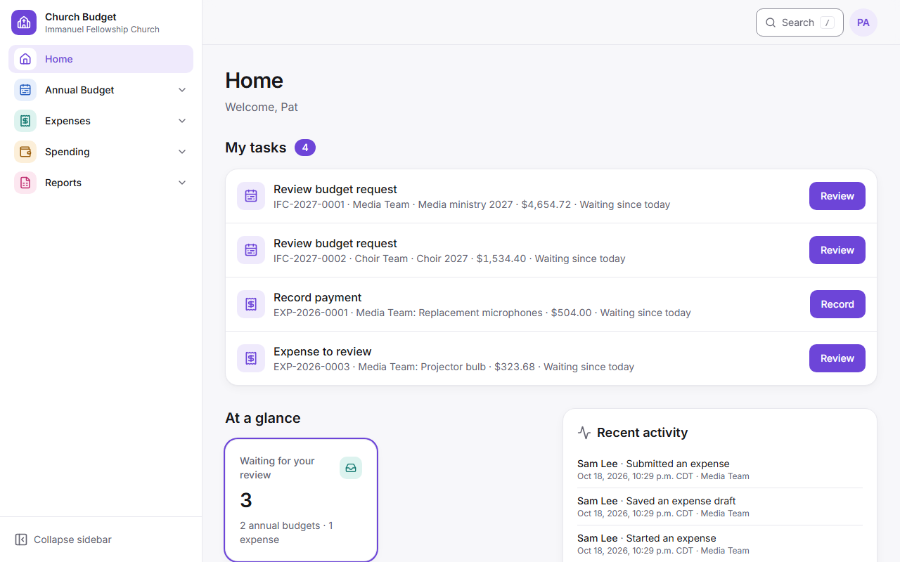

### Getting around

- The menu is grouped by area: **Home, Annual Budget, Expenses, Spending, Reports, Admin**, each with its own colour. You only see what your roles allow.
  - **Computer:** choose an area in the sidebar to open its pages; the area you are in opens by itself, and a dot marks it when it is closed. **Collapse sidebar** shrinks it to coloured icons.
  - **Tablet:** the coloured icons down the left side are the areas; tap one to see its pages.
  - **Phone:** the bar at the bottom has Home and your main areas; each opens your most-used page there. **More** opens only the pages the bar doesn't show, grouped by area, plus Help and Privacy. Each area is folded: tap its name to see its pages. The area you're in starts open.
- **Search** (top bar, or press `/`): type a reference number such as `EXP-2027-0042` or `IFC-2027-0007`, a department, or a person.
- **Breadcrumbs** under the top bar show where you are; click any part to go back up.
- Every reference number, department and person name is a link.

### Notifications

The **bell** in the top bar shows what has happened to your budgets and expenses: everything the app emails you also lands here. A red number shows how many you haven't opened yet.

- **Computer and tablet:** select the bell to see the latest, either **All** or only those that **Need action** (an approval, a question to answer, a reminder). **Mark all as read** clears the number; **See all notifications** opens the full list.
- **Phone:** the bell opens the **Notifications** page.
- The **Notifications** page groups them by **Today**, **Yesterday**, **This week** and **Earlier**. The buttons along the top show **Unread**, **Needs action**, or one area (Annual Budget, Expenses, Spending, Budget years, Departments & people).
- Select one to open what it's about; it is then marked as read. Only you see your notifications. Emails still come as before.

### Get the app (install it and get alerts)

Church Budget can sit on your phone's home screen and alert you like any other app. It's free. Open **Get the app**, at the bottom of every page, in your account menu, or from **Get these on your phone** on the Notifications page.

- **iPhone or iPad:** open the app in **Safari**, tap **Share** (the square with an arrow), then **Add to Home Screen** and **Add**. Open it from the home screen and sign in.
- **Android:** in **Chrome**, tap **Install the app** on Get the app, or choose **Install app** (or **Add to Home screen**) from Chrome's menu.
- **Computer:** in Chrome or Edge, select **Install the app**, or the install icon in the address bar. It opens in its own window.
- **Alerts:** when you open the installed app, a card at the top asks you to **Allow alerts**; it stays until you do. (**Turn on alerts** on Get the app does the same.) Every notification in the bell also pops up on that phone or computer, and the app's icon shows how many you haven't read. Tap an alert to open what it's about. **Send a test alert** checks it works. On an iPhone, alerts work only in the app opened from the home screen (iOS 16.4 or later).
- Alerts show a short line such as "An expense needs your approval" on the lock screen. Amounts and details stay in the app. Emails still come; alerts are extra.
- Alerts stay on. Only a **System Administrator** can turn them off: for everyone in **Admin → Settings → Texts and alerts**, or for one person on their page in **Users & Roles** (**Phone alerts**), which also lists their devices and removes a lost phone. Changes are recorded in the activity log.

### Your account

From the account menu: theme (light, dark or system), **Away** (accountants, backup approvers, Board Chair and Vice-Chair), and sign out. A department's Primary sets Away on **Annual Budget** instead (section 4).

Every email the app sends always goes to you straight away; emails can't be turned off.

### Reminder texts

If your Planning Center profile has a mobile number, the reminders also come as a short text: the annual budget deadline (7 days and 1 day before), expenses waiting for your approval (daily after 5 days), approved expenses waiting to be paid, and an approved purchase not yet bought or claimed. Texts are sent between 9:00 a.m. and 8:00 p.m.; a reminder made overnight arrives at 9:00. Each text links to the app, where you sign in as usual.

- To change the number, update your mobile number in Planning Center; the app picks it up overnight.
- To stop the texts, reply **STOP** to any of them. The reminder emails still come.

### Money on screen

All amounts are Canadian dollars. Every total shows **Subtotal**, **Sales tax (12%)**, and **Total (incl. tax)**. Prices you type are **before tax**; the app adds tax once on the subtotal.

---

## 2. Requesters: annual budget

Each department submits **one** annual budget for the year. Once it has one (a draft or a submitted budget), nobody can start another for it: everyone in the department works on that one, and after submitting you edit it instead. **My department's budget** shows each of your departments' budgets with the next step (**Continue draft**, **Respond**, **Edit budget** or **View budget**); **Submit annual budget** appears only for a department that doesn't have one yet.

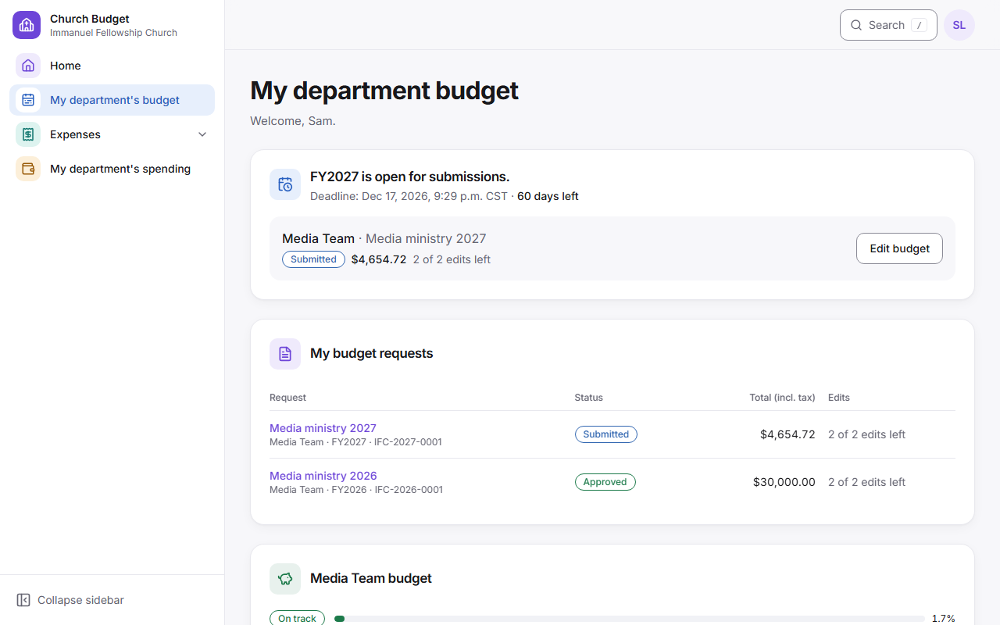

### Submit your department's budget

1. Go to **Annual Budget → My department's budget** and choose **Submit annual budget** (or **Continue draft** if your department has one). The page shows the open cycle, its deadline and how many days are left.
2. **Choose your department.** Your own departments are listed first, marked **Yours**; type in **Search departments** to narrow the list. If yours isn't there, choose **Other (type your department)** and type its name. If it looks like one on the list, the app asks "Did you mean …?". A new name is added as a new department for the System Administrator to confirm, and you can still finish and submit. A department that already has a budget this year is marked **Has a budget**, and choosing it says where that budget stands instead of starting another: a draft or a returned budget opens in the editor with **Continue it**; a submitted one opens on its page with **Open it**, so you can review it first and edit it while edits are left. An approved or declined budget opens to view only; it can't be changed. If you lead several departments, you can start a budget for each one that doesn't have one yet.
   - **Start from last year's request:** if your department submitted a budget in an earlier year, tick this under the list. The new draft gets last year's title, reasons and items (names, quantities, prices, links and notes) at today's tax rate. Last year's approval, history and messages stay with last year's budget. Check every item before you submit; it's a normal draft.
   - New Group Leaders who don't have a department yet see **Choose your department** on the "You're verified" screen while a cycle is open, and become their department's representative by picking it.
3. **Request information:** give a title and write why the department needs this budget.
4. **Budget items:** the items are a list with one row each: name, quantity, unit price (before tax) and the line total. Open **Link and notes** under an item to add a product link or a note (a $0.00 item needs a note). Use **Add item** (or press Enter in the last item). Each item's **⋯** menu has **Move up**, **Move down** and **Remove**; removing an item that has details asks first. The summary on the side (a bar at the bottom on a phone; tap **Show breakdown**) updates as you type.

   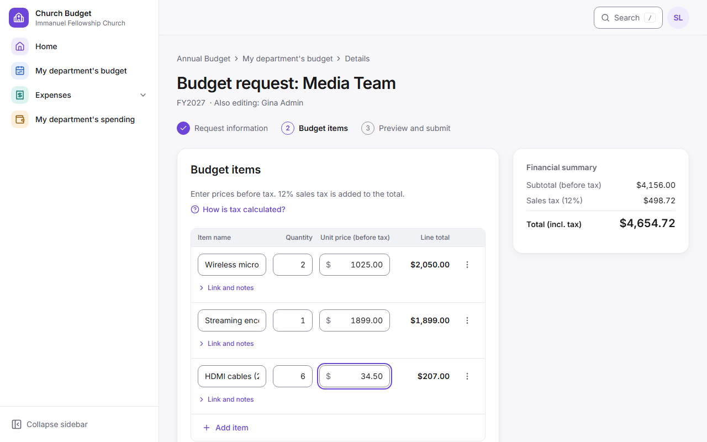

5. Your work saves automatically as a **draft** ("Saved just now"). Use **Save and exit** to save and go back to your budget page, or just leave and come back; if your sign-in times out, the app keeps what you typed on this device and offers it back. A draft that was never submitted can be deleted with **Delete draft**.
6. **Preview:** check everything, including the totals. Use **Edit** to go back to a section.
7. **Confirm submission**, then **Submit request** in the dialog. You see the reference number (for example IFC-2027-0001), the total including tax, and how many changes you can still make. Your receipt email arrives shortly, and the accountant is told.

### After you submit

- You can **edit** a submitted budget **twice** before it is decided. The app shows how many edits are left. Edits are shared by everyone in your department.
- If the accountant asks a question (**Returned for clarification**), it appears in My tasks. Answer it and resubmit; this does **not** use an edit.
- Use **Messages** on the budget (once it's submitted) to talk with the accountant; each message emails the other side. Messages can't be changed after sending, don't change the budget or use an edit, and stay open after the decision. A link you paste becomes clickable. Your budget list shows "1 new message" until you open it.
- The accountant's question, decline reason or approved amount appears on your budget's page and is emailed to everyone who represents your department. The approved amount may be different from what you asked for; it always includes tax, and the page and the email show it beside what you asked for.
- Some years the accountant decides every department first and shares all the decisions at once. Then your budget stays **In Review** with "Decisions will be shared on" and the date, even if it has been decided, and you can't change it. You're emailed on that day. This holds even if you also have a finance, board or administrator role: your own department's pages (your budget, My department's budget, the start form and Activity on this budget) follow the release like everyone else's in the department.
- Before the deadline you're reminded 7 days and 1 day ahead if your department hasn't submitted (by email, and by text too if your Planning Center profile has a mobile number; see **Reminder texts** under Getting started). You're also told when a budget cycle opens, closes or reopens, and when your deadline changes.
- You're also emailed when you submit (your receipt), when anyone in your department changes the budget, when the review starts, and if it's reopened. Each email says what changed and what, if anything, you need to do. Its link asks you to sign in.
- **Emails** at the bottom of your budget's page lists every email sent to your department about it, and whether it went. If one says **Couldn't be sent**, the budget itself is safe; ask the administrator to check the address.

### See how much is left

**Spending → My department's spending** shows, for each department you lead, the approved budget, any amendments, the available budget, committed, spent and remaining, with a bar showing how much is used (On track, Nearing limit or Over budget). Below it is every spending entry: the date, payee, description and amount. Refunds show as a minus amount, and voided entries stay listed, struck through. Choose another **Budget year** to look back. Your annual budget page shows the same panel with the latest five entries.

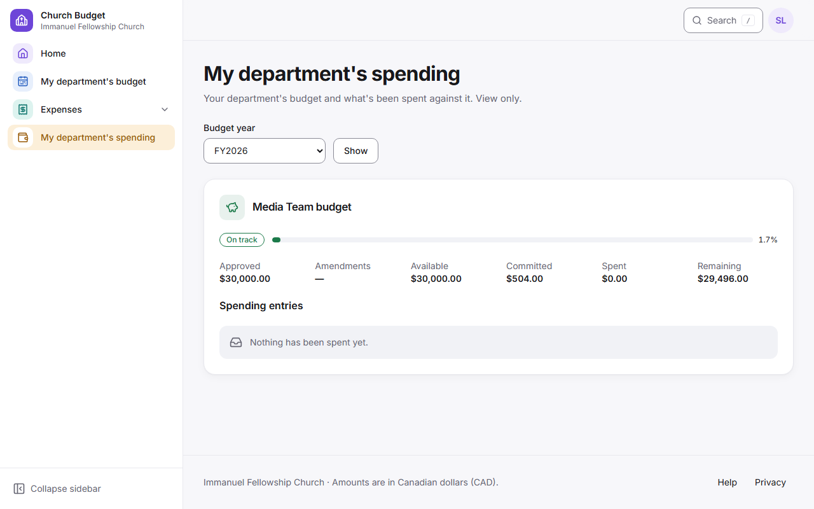

You can only see your own departments. How each item was paid and its receipt or cheque numbers are kept with the accountant.

---

## 3. Requesters: expenses during the year

Spend against your approved annual budget with two kinds of submission:

| Use | When |
|---|---|
| **Purchase request** | Before buying: "May we buy 2 microphones?" Approval sets the money aside (Committed). |
| **Expense claim** | After buying: "I paid $112.00, please pay me back." Attach receipts. Submit within 90 days of buying. |

You can submit expenses once your department's annual budget is approved and the decision has reached you.

### Submit an expense

1. Go to **Expenses → New expense** and pick the type.
2. Choose the department and the **budget year** it's charged to (this year's is chosen for you). The **budget strip** shows Available, Committed, Spent and Remaining, and, once you enter amounts, **Remaining after this**.
3. The form has numbered steps, each on its own card. **Step 1, What and why:** the title and why it is needed (up to 4,000 characters).
4. **Purchase request:** add items with their prices before tax (the app adds the 12% sales tax), optionally pick the annual budget item it comes from, and choose **How it will be bought**: the Church Administrator buys it on the church account, you buy it and submit a claim, or the supplier invoices the church. Under **Attachments** you can add a quote, invoice or photo of what you're buying (optional; up to 5 photos or PDFs, 10 MB each).
5. **Expense claim:** add one line per receipt (date, store, what you bought, amount paid including tax, receipt number). No tax is added: the receipt already includes it. Then:
   - If you bought something you asked for beforehand, **link the approved purchase request**, so the money set aside for it is released.
   - Choose **who should be paid**: you, someone else (their name, and their email for an e-transfer), or **Church card** if nothing is owed. Then choose cheque or e-transfer. Never enter bank account numbers.
   - Add the **receipts**: up to 5 photos or PDFs, 10 MB each. On a phone, **Take photo** opens the camera; iPhone photos are converted automatically. If you have no receipt, tick **No receipt available** and say why.
   - Receipts more than 90 days old need a short explanation.
6. If it would take the department over budget, you'll see a warning with the amount. You can still submit: explain why it's needed, and the accountant and the Board Chair decide. If it's approved, the department shows as over budget.
7. **Save draft** keeps it for later. **Preview**, then **Confirm submission**. You get a receipt by email with the reference number, like EXP-2026-0042.

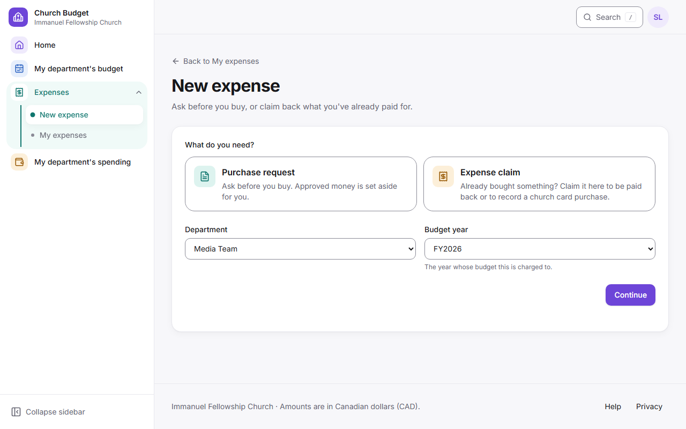

### What happens next

- **Messages** at the bottom of an expense let you, the accountant, the Board Chair and the Church Administrator ask and answer questions; each message is emailed to the others. A message doesn't change the expense.
- The accountant and the Board Chair (or Vice-Chair) are asked at the same time and can approve in either order. Once both have approved, the Church Administrator pays or buys and records how. You and every other leader of the department get an email at each step, and **My expenses** shows a tracker with where it is.
- You can **change** the expense until the accountant starts reviewing it, or **withdraw** it. If the accountant returns it with a question, change it and send your answer.
- An approved purchase request you buy yourself stays set aside until you submit the claim linked to it. If it won't go ahead, **cancel** it with a reason so the money goes back to the budget.

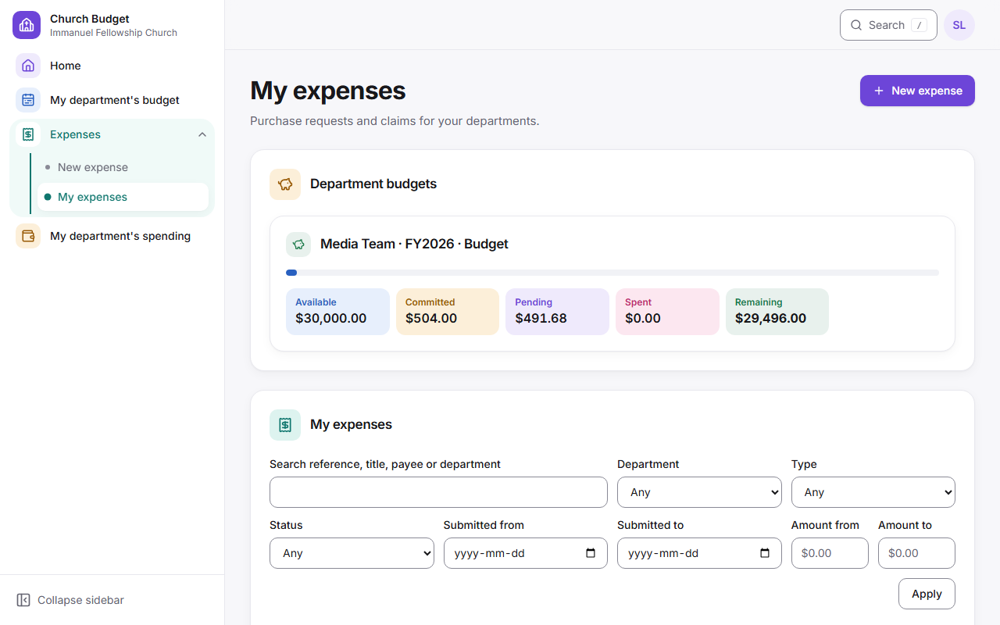

---

## 4. Primary and Backup requesters

Each department has a **Primary requester** (accountable for the department's budget) and can have up to two **Backup requesters** who cover: **Backup 1** and **Backup 2**. Two Backups help a department that runs at two locations.

- All of them can do everything for the department: submit and edit the annual budget, answer questions, send messages, and submit expenses.
- All of them see the department's tasks in My tasks. Reminders go to the Primary first. If the accountant's question is still unanswered a day later, the Primary is reminded; after 3 days (the administrator can change this), both Backups are reminded too and the task shows **Backup reminded**.
- **Primary: choose your backups.** On **Annual Budget**, under **{Department}: leaders**, choose a verified Group Leader and **Backup 1** or **Backup 2**, then **Make Backup**. The System Administrator is told and can change it. Changing the Primary is the administrator's job.
- **Primary: going away?** On **Annual Budget**, under your department's leaders, set **Away** with the first day away and (optionally) the day you're back. Your Backups get the reminders straight away, and everyone in the department sees "Covered by … until …". You need a Backup first. **Turn off Away** when you're back early.
- If the Primary leaves the role, Backup 1 becomes Primary automatically, Backup 2 moves up to Backup 1, and the System Administrator is asked to fill the empty Backup place.

---

## 5. Accountant

### Annual budgets

1. **Annual Budget → Review dashboard** shows the cycle at a glance: departments expected, submitted and outstanding, requests awaiting review, and the total requested and approved (including tax). Choose another cycle, a status, a department or search by reference, department, requester or title; the filters stay in the address, so Back and shared links keep them.
   - **Review queue**: every submitted budget, changed ones (**Updated**) first. Drafts never appear here.
   - **Department completion**: every department with its representative, status (**Not submitted**, **Draft exists**, or the budget's status), totals and next step.
   - Budgets waiting for you also appear in **My tasks** on Home.
   - **Annual Budget → Departments** lists every department with its leaders (Primary and Backups, each an email link), whether the Primary is away and who covers, its budget status, requested and approved amounts, what is left to spend, and any deadline extension. Leaders are changed by the System Administrator.
   - When the cycle has a board-approved church total, a bar shows how much is allocated so far, for example "Allocated $140,000.00 of $150,000.00 board total · $10,000.00 left to allocate".

   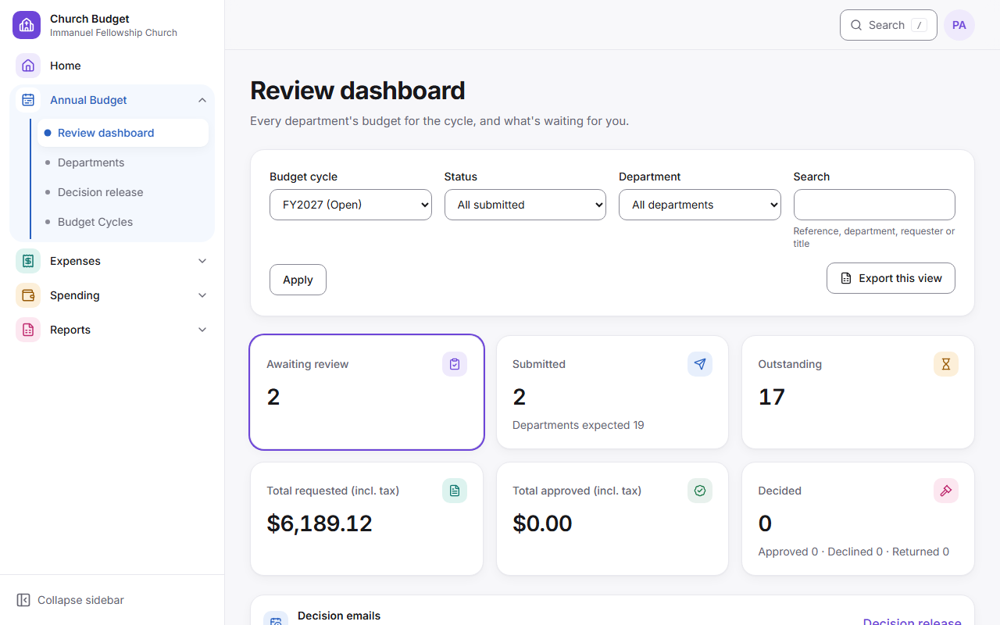

2. Open a budget with **Review**. Opening it marks it **In Review**. You see the details, the items, the revision history (what changed in each version) and earlier decisions. Then choose:
   - **Approve as requested**;
   - **Approve a different amount**: type the one approved total **including tax**, a note, and optionally the board reference. The app shows the tax inside it as you type (for example $30,000.00 includes $3,214.29 sales tax on $26,785.71) and how it compares with what was asked;
   - **Adjust individual items**: change approved quantities or prices before tax (quantity 0 leaves an item out) and add a note; the app adds tax;
   - **Return for clarification** with your question;
   - **Decline** with a reason.
   If approving would take the year's approved budgets past the board total, the app warns you by how much. You can still approve.
   A budget for a department that's still **proposed** (typed under **Other**) can't be approved until the System Administrator adds it to the list or merges it. You can still return or decline it.

   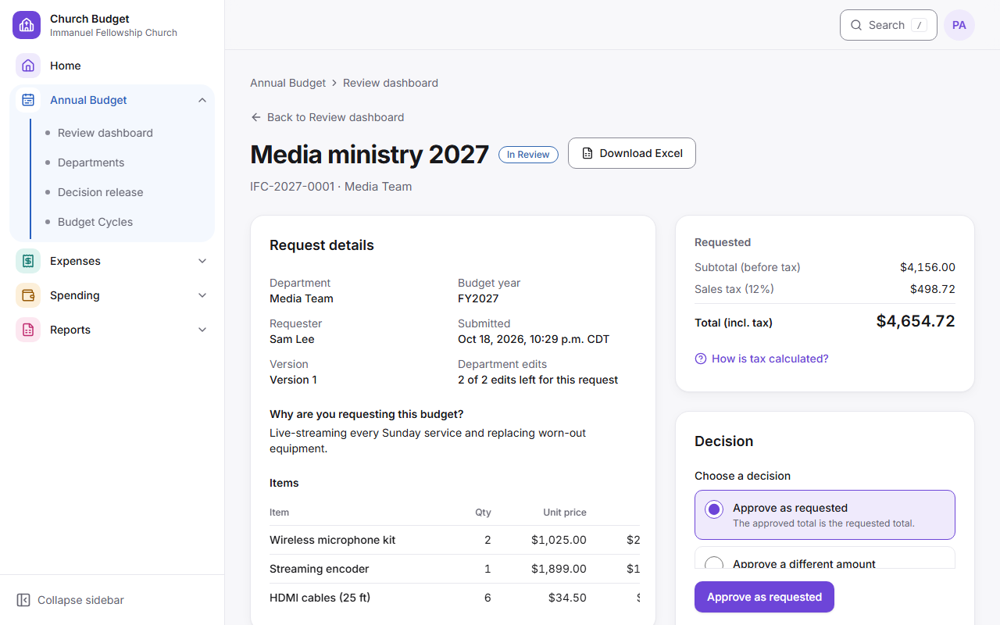

3. **Review decision**, check the summary (requested, approved and the difference, all including tax), and confirm. The department sees the decision on its budget straight away and is emailed; you get a copy for your records.
4. **Decision release** (Annual Budget → Decision release) chooses how departments hear about approvals and declines:
   - **Send immediately** (the usual): each department is emailed when you confirm.
   - **Hold and release on a date:** choose the date and time (church time) and, if you like, one message for every email ("Thank you for your work this year…"). Decide every department; they keep seeing **In Review** and get nothing until then. Questions are never held. All the emails go out within the hour after that time; **Release now** sends them at once. You're warned the day before if some departments aren't decided, and budgets decided after the time go straight out.
   - The page shows Approved, Declined, Undecided and Not submitted, and who gets which email. **Release now** sends everything held at once, even after the release time if the emails haven't gone yet; **Cancel schedule** goes back to sending immediately and sends what's held. A banner on every review screen reminds you while decisions are held.
5. **Second approval for large budgets** (if the administrator has turned it on): when an approval reaches the set amount, the button reads **Approve (needs second sign-off)**. After you confirm, the budget is **Awaiting Second Approval** and the department is told it's awaiting final sign-off. Another accountant or backup approver (not you, and nobody who leads the department) gets a task: they open it and choose **Give second approval**, or **Refuse** with a reason, which sends it back to In Review for you.
6. **Reopen** an approved or declined budget with a reason if the board reconsiders. It goes back to the department as Returned for Clarification, without using one of its edits, and the earlier decision stays in the history. If expenses already rely on an approved budget, the dialog shows how much is committed, spent and waiting, and you tick a box to confirm before it reopens.
7. You're emailed when a budget is submitted, changed or answered if you are the Primary accountant (every accountant is, until one is chosen in Settings). **Emails** at the bottom of the review screen lists every email sent about the budget, copies included.
8. You cannot decide a budget for a department you represent; the page says so, and another accountant or the backup approver decides it.
9. **Messages** at the bottom of the review screen: write to the department's representatives (each message emails all of them), and read their replies. The review queue shows "1 new message" on a budget until you open it. Use **Return for clarification** when you need the department to change the budget; a message doesn't.

### Expenses (first approval)

1. **Expenses → Review queue** shows what's waiting, the total, how many are over budget and the oldest. Filter by department, type, status or over budget only. New ones are also in My tasks.

   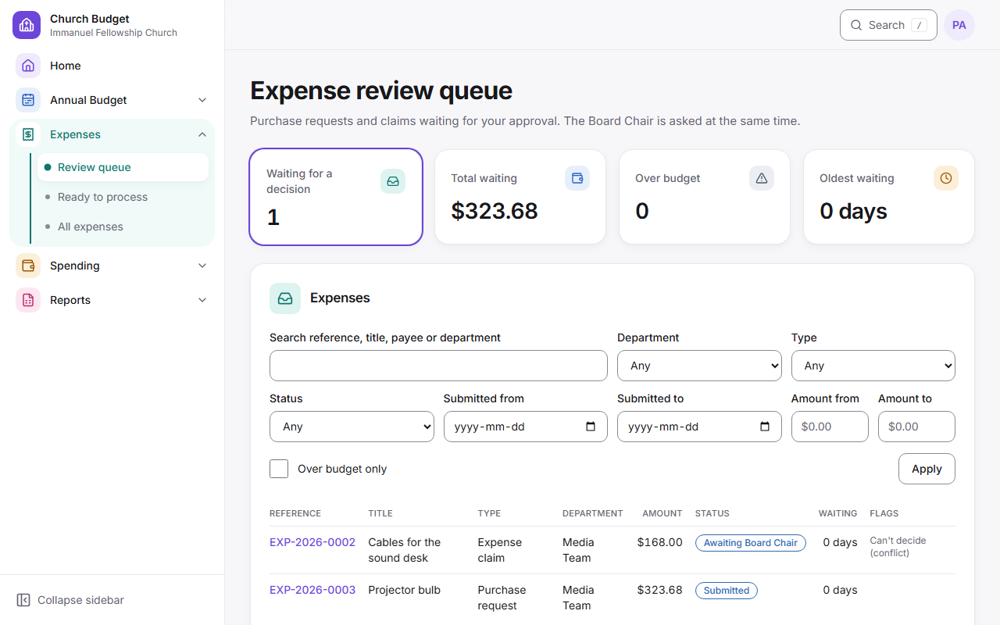

2. Open a submission to see its items or receipt lines, the receipt files, and the department's Remaining now and if approved. Opening it marks it In Review, so the department can't change it any more.
3. Warnings show above your decision:
   - it takes the department over budget (by how much, worked out now, with the requester's explanation);
   - a receipt line matches another claim;
   - a receipt is old;
   - there's no receipt;
   - a claim is more than the purchase request it closes.
4. Choose **Approve and send to Board Chair**, **Approve a different amount** (one total including tax, never more than asked, with a reason), **Return for clarification** with a question, or **Decline** with a reason. Approving doesn't charge the budget: the Board Chair's final approval does.
5. You can't decide an expense for a department you lead, one you submitted, or one that pays you; the screen says so.
6. **Expenses → All expenses** lists every expense with search and filters. **Reports → Expenses and payments** downloads them.

### Spending

Record spending, refunds and corrections, make **budget amendments** with a reason, and **close the budget year** at year-end (**Spending** area).

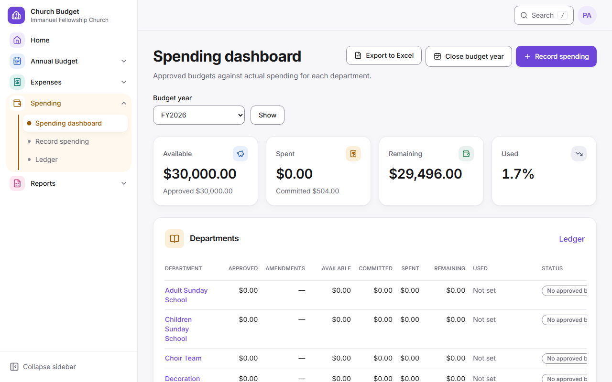

**A budget cycle is the budget year.** While it's **Open**, departments submit their annual budget until the deadline, and spend from their approved budget all year. Submissions end at the deadline (or a department's extension), not when the year closes. **Closing** the year ends it: spending stops, and the budget left unspent goes back to the church. So last year and next year can both be Open for a while: one being spent, the other taking budgets.

**Close budget year.** On the Spending dashboard, choose the year and then **Close budget year** (or **Close budget year** on the cycle's page). The accountant, backup approver, Board Chair and Vice-Chair can close a year. After the year's spending period end (Dec 31 unless it's set on the cycle), the accountant is emailed once that it's time to close it.

1. The page shows **Unspent**: what's left across the departments, which goes back to the church when the year closes. **Before you close** lists the year's expenses still waiting for a decision, and the ones approved but not yet paid or bought. Decide or pay them first; **Close budget year** appears once both lists are empty.
2. **Close budget year** asks you to confirm. Then the cycle reads **Closed**: nobody (you included) can record, correct or void that year's spending, no new expenses can be started for it, and it no longer shows in departments' budgets. Viewing and exporting still work. Every department leader and the Church Administrators are emailed.
3. After closing, **Approved purchase requests not yet bought** lists the ones still open. For each, either **Open to cancel** (on the expense page) or give a reason and **Carry into** next year. Carrying over moves the money set aside into next year's budget; the request stays approved with its reference, and the department's leaders and the Church Administrators are emailed. Next year's budget cycle, and the department's approved budget in it, must exist first.
4. To change something after closing, **Reopen budget year** with a reason. It's kept in the activity log, and departments are told.

### Away

Choose **Away** in the account menu (Account settings). Give the first day away and, if you know it, the day you're back. While the Primary accountant is away, the accountant emails (new submissions, changes, answers, messages, reminders) go to the backup approvers who aren't away themselves, and the Review dashboard says who is covering. You can still sign in and work. If everyone is away, the emails keep coming to the Primary. Backup approvers can set Away too, so they aren't chosen to cover.

### Reports

**Reports → Exports** has a card for each report (each explains what's in it before you download), and **Reports → Analytics & Audit** for charts and the activity log (section 9).

- **One budget:** **Download Excel** at the top of its review screen, or the **Excel** button on its row in the Review dashboard's department list.
- **What you're looking at:** **Export this view** on the Review dashboard downloads the cycle with the status and department you filtered by (the search box isn't applied).
- **Any combination:** **Reports** has the cycle, department and status filters, and explains what's in the workbook before you download.

Every workbook has a **Summary** sheet (one row per budget, requested and approved subtotal, sales tax and total, the difference, who approved it and when, and a Total row) and a **Line Items** sheet (each item as requested and as approved, with the reason for any change). A one-budget workbook ends with its Subtotal, Sales tax and Total. When a different total was approved, an **Overall adjustment** row makes the approved items add up to it. Amounts are the app's own figures to the cent, as numbers you can sum. Drafts are never included. Each download is recorded in the activity log.

**Spending workbook.** **Export to Excel** on the Spending dashboard downloads the year shown; **Reports → Spending and budget vs actual** lets you choose the year and one department or all. It has three sheets: **Budget vs Actual** (each department's approved, amendments, available, committed, spent, remaining, percentage used and status, with a Total row that matches the dashboard to the cent), **Ledger** (every spending entry with payment method and reference; refunds are negative, voided entries are listed but not counted in the total) and **Amendments**. The Church Administrator and the System Administrator can download it too.

---

## 6. Board Chair and Vice-Chair

1. When an expense is submitted, you and the accountant are both emailed at the same time, and it's in your tasks: **Expense to approve**. Either of you can approve first.
2. Open it from the email or **Expenses → Awaiting my approval**. You see the amount, the accountant's approval and note if they've already approved, receipts, and the department's remaining budget. If it takes the department over budget, a warning shows by how much, with the requester's explanation; the second approval is what charges it, and the department then shows as over budget.

   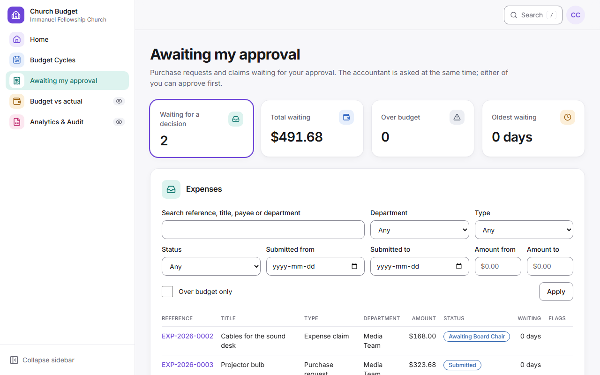

3. Choose **Approve**, **Approve a smaller amount** (including tax, with a reason), **Return for clarification** to the department with a question, or **Decline** with a reason.
4. Once both of you have approved, the budget is charged, and the requester and the Church Administrator are emailed. If your amounts differ, the lower one is approved.
5. The Chair can turn on **Away** (account menu); the Vice-Chair then gets the emails and tasks. The Vice-Chair also decides when the Chair represents the department, submitted it, or is the payee. Otherwise the Vice-Chair's screen says the Chair decides it. Decisions show who made them, and in which role.
6. If you haven't decided an expense within 5 days, you get a reminder email every day until you do, and a text if your Planning Center profile has a mobile number. The accountant gets the same daily reminder for expenses waiting on them.

These screens are designed for a phone.

You can also read **Spending → Budget vs actual** (every department's approved, spent and remaining budget) and **Reports → Analytics & Audit** (section 9), without changing anything. In **Annual Budget → Budget cycles** you can create, edit and open a budget year, as the accountant can (section 8, Budget cycles). To end a year, open it there and choose **Close budget year** (section 5, Spending): spending stops and the unspent budget goes back to the church.

---

## 7. Church Administrator

### Pay or buy approved expenses

1. You get an email "Approved, ready for processing" and a task. Open **Expenses → Ready to process** (oldest first). It shows the total waiting, how much is owed to people, and what was paid in the last 30 days.

   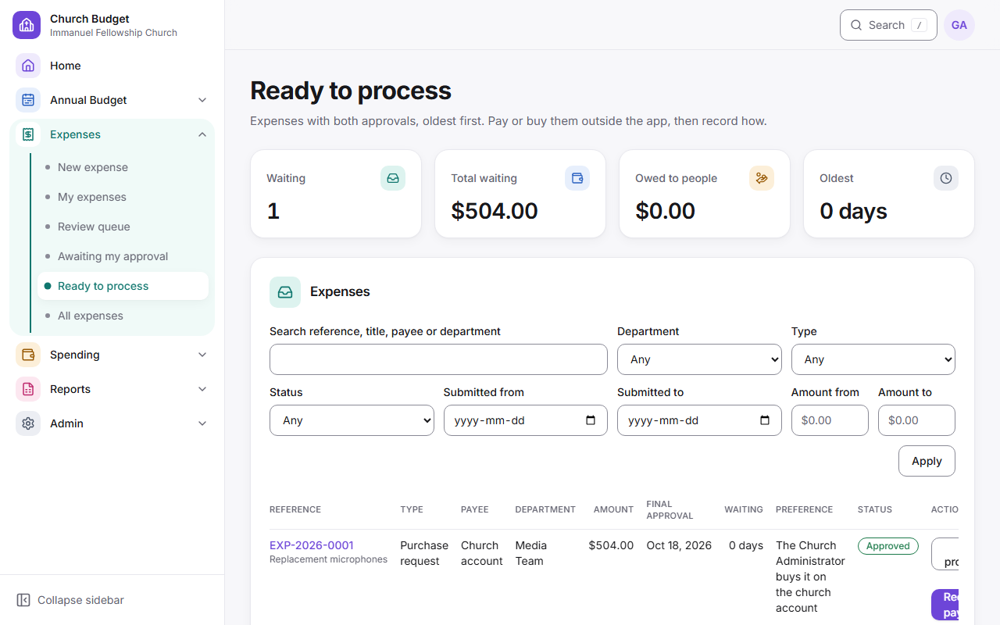

2. Select **Start processing**. The requester is told.
3. Pay or buy outside the app, then select **Record payment**. Choose how it was paid; the form asks for what that needs:
   - **Cheque:** the cheque number and the two signers, from the active signing authorities. With fewer than two, a cheque can't be recorded; ask the administrator.
   - **Church card:** the last 4 digits, the transaction reference and who bought it.
   - **Cash:** who received it, and whether the receipt was signed.
   - **E-transfer:** the reference.
   - **Supplier invoice (EFT):** the invoice number and the supplier.
   - **Other:** what it was.
   - Then the date paid and the amount (the approved amount unless it differs, which needs a note).
4. Confirm with the button, which names the amount and method. The requester and payee are emailed. A claim shows as Paid (a church-card claim, with nothing owed, as Closed), and a purchase as Purchased.
5. **Spending → Ledger** shows the spending entry for each approved claim and purchase, with how it was paid. Nothing needs typing twice.
6. Approved expenses not processed after 14 days are listed in a reminder email (and a short text to anyone with a mobile number in Planning Center).

### Record other spending

**Spending → Record spending** for spending that did not come through an expense. You can **correct** or **void** an entry with a reason; nothing is deleted. You cannot record into a closed budget year.

### Reports

Spending and budget-vs-actual exports, and spending analytics on **Reports → Analytics & Audit**.

---

## 8. System Administrator

You can **see everything** but cannot approve or pay unless you are also given that role. **Annual Budget → All budgets** lists every department's budget for the year, read only.

### Users and roles

**Admin → Users & Roles**: add people, assign roles and departments, deactivate people who leave. Keep at least two System Administrators.

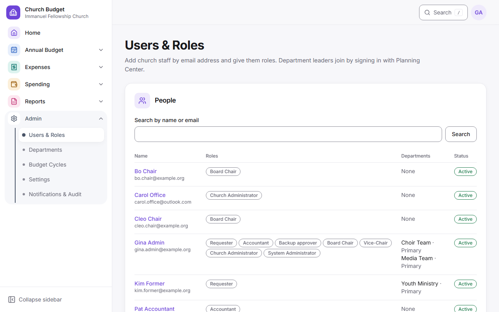

- **Staff sign in like leaders.** Anyone marked as a Ministry Leader in Planning Center can sign in by themselves. A new staff member who signs in lands on a "You're verified" screen; find them under **Needs attention** and give them their roles.
- **Add a staff member** ahead of time: choose **Add a staff member**, find them under **Find them in Planning Center**, open their name, tick their roles and **Add staff member**. They're linked to their Planning Center profile, so they can sign in straight away. **Not in Planning Center? Add by email** is for people like the Church Administrator who sign in with an emailed code.
- **Linking by hand:** an account added by email can be linked on the person's page under **Planning Center profile**. Planning Center sign-in never links accounts by email on its own, because people can change the email on their own profile.
- **Expense submitter:** to let someone who doesn't lead a department submit expenses for it (for example a volunteer who buys for Media), open their page and, under **Expense submitter**, choose the department and **Add**. They need the Requester role and must be a verified Group Leader in Planning Center, like every requester. The Church Administrator can be made a submitter too, to submit on a department's behalf; someone else then records the payment. They see and change only what they submit; the department's leaders see it too and get its emails. **Remove** stops new submissions; what they already submitted stays.

### Departments

**Admin → Departments**:

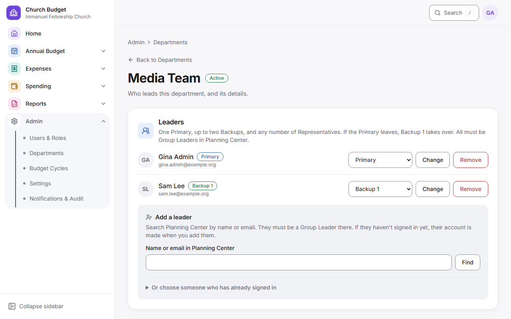

- Add departments (or paste a list), rename, deactivate. At setup, paste the church's 18 departments; nobody needs to be assigned in advance, because leaders join by picking their department. **Others** in the list is skipped: it's the form's **Other** option, not a department.
- **Leaders** (top of the department's page): each leader shows their role: **Primary**, **Backup 1**, **Backup 2** or **Representative**. To change it, pick the new role and choose **Change**; giving someone a place that's taken makes its holder a Representative, and moving a leader into another leader's place swaps them. **Remove** takes them off the department. Use the **No backup** filter on the list to find gaps.
- **Add a leader:** type their name or email, choose **Find**, then pick their role and **Add**. They must be a Group Leader in Planning Center. If they haven't signed in yet, their account is made then, and they sign in with Planning Center. Someone whose email is already used by an account must be linked on their Users & Roles page first.
- **Proposed** tab: departments people typed under **Other**. Choose **Add to list**, **Merge into…**, or **Reject** with a reason.
- **Department details:** rename it (past requests keep the old name), and set its **Name in Planning Center** if the **Ministry Department** field there calls it something else, like "Media" for Media Team. Leaders whose field names the department join it when they sign in, marked **From Planning Center**; nobody is removed automatically. **Deactivate department** is at the bottom.
- Linking a department to a Planning Center team, group or tag is turned off; the Ministry Department field and **Add a leader** cover it.

### Budget cycles

**Admin → Budget Cycles**: create the year (the first is FY2027), set the deadline and board-approved church total, open it, and choose whether decision emails go out immediately or at a scheduled time. The accountant, backup approvers, the Board Chair and the Vice-Chair can do all of this too, from **Annual Budget → Budget cycles**: create a year, open one to **edit its details** (name, start date, tax rate for new submissions, board-approved total and reference, spending period end), change its deadline, give extensions, and open it. Closing or reopening the year is on **Spending → Close budget year** (section 5), for finance and the board only. A cycle starts as a draft; opening it emails every department. The budget year can't change once a department has a budget for it.

- **Change deadline**: pick the new date and give a reason; departments that haven't submitted are emailed.
- **Give extension**: a later date for one department only, with a reason.

### Settings

**Admin → Settings** is grouped into categories down the left (a row of tabs on a phone): **General** (branding, time zone), **Money** (sales tax, second approval), **People** (the Primary accountant, signing authorities), **Sign-in** (Planning Center and the requesters failing verification) and **Reminder texts**. Together they cover: branding (logo, names, colour), sales tax rate (applies to new submissions only), **Second approval for large budgets** (an approved total, including tax, at or above which a second accountant must sign off; empty means off), **Reminder texts** (whether Twilio is connected, texts sent this month, and the monthly limit; 0 stops texts), church time zone, the Primary accountant, signing authorities, Planning Center (connection, sign-in options, the Group Leader and Ministry Department fields, and **Test a person**), and the requesters failing verification.

- **Sales tax**: type the new rate (for example 12 or 12.5) and confirm. Requests already submitted keep the rate they were submitted with.
- **Accountants**: more than one person can have the Accountant role (give it in Users & Roles). Choose the **Primary accountant**, who gets the accountant emails; everyone else with the Accountant or Backup approver role is a backup approver. If the Primary accountant loses the role or is deactivated, choose a new one here.
- **Church time zone**: deadlines, release times and emails use it (default America/Winnipeg).
- **Branding** (Settings → **Change the branding**): upload or replace the **Logo** (PNG, JPG or SVG, up to 1 MB), change the **Church name** and **Application name**, and pick the **Accent colour**, which is used for buttons, links and the selected page. As you type a colour, the page previews it in the light and dark themes and checks it can be read. A colour that's too light is refused, and **Use … instead** picks the nearest shade that passes. **Reset to default** brings back the original purple. You can also add a square **Browser icon** (PNG or SVG) for the browser tab and phone home screen. Changes show for everyone straight away, on the sign-in screen, in the app, in emails and in Excel exports. Emails and Excel can't show an SVG logo, so with an SVG they show the church name instead; use a PNG if you want the logo there too. **Remove logo** brings back the default mark, and the old file stays in the history.
- **Sign-in and Planning Center**: the contact email shown to people who can't sign in, which sign-in buttons appear, the custom field and the values that count as a Group Leader, and which roles need the check.
- **Ministry Department**: the second Planning Center field, which names each leader's department, and what it does. **Off** ignores it. **Suggest** (the default) adds leaders to the departments their field names, and they can still pick another department on the form. **Restrict** lets leaders submit only for the departments their field names, plus any you assigned yourself, and hides **Other** on the form. Use **Test a person** to try the field and values on someone before you save. The **Requesters failing verification** list shows who is suspended or not yet verified.

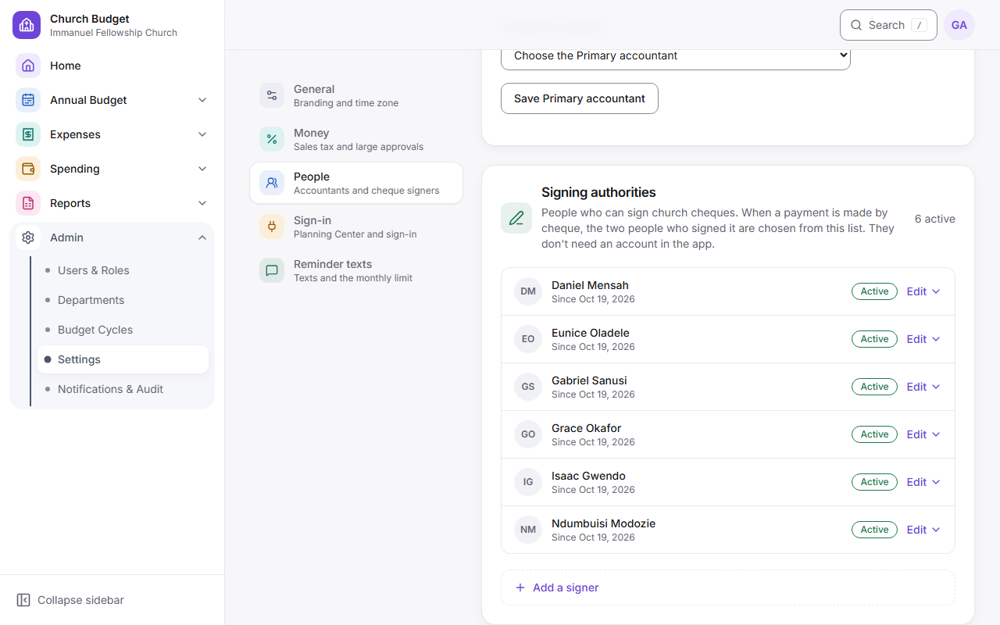

**Signing authorities** (Settings → People): the people who can sign church cheques, one slim row each, active ones first. They don't need an account in the app. Open **Add a signer** at the bottom and choose **Add signer** when someone can sign cheques (name, optional email, and the date they start). To fix a spelling or remove someone, click their row (**Edit**); **Remove** takes the date they stop and an optional reason. Removed signers stay on the list and on every payment they signed. When the Church Administrator records a cheque payment, they pick the two people who signed from this list, so keep at least two active; the page warns you when fewer remain.

### Keeping it healthy

You're emailed when something needs you: a leader joins or proposes a department, a new leader is waiting for a department, a requester is suspended because Planning Center no longer lists them, Planning Center can't be reached, someone without access tries to sign in, or the Primary accountant is cleared. Once a day you also get a list of any emails that couldn't be sent after every retry.

Emails that don't go are retried for about three days. **Admin → Notifications & Audit** lists every email with its status; filter by **Couldn't be sent** to see failures and the reason. After fixing an address or the Resend settings, use **Send again** on one email or **Send all failed again**. **Send a test email**, on the same page, sends a sample email to any address (up to 20 a day) to check that email works and lands in the inbox; the [deliverability test](email-deliverability.md) uses it. Check the page, and **Reports → Analytics & Audit → Access** weekly (see the [go-live checklist](go-live-checklist.md), section 4).

---

## 9. Analytics and Audit (staff)

**Reports → Analytics & Audit** is for church staff: the accountant and backup approver, the Board Chair and Vice-Chair (read only), the Church Administrator and the System Administrator. Department leaders don't have it; each of their budgets has its own **Activity on this budget** page instead. It has three tabs, and what you see depends on your roles.

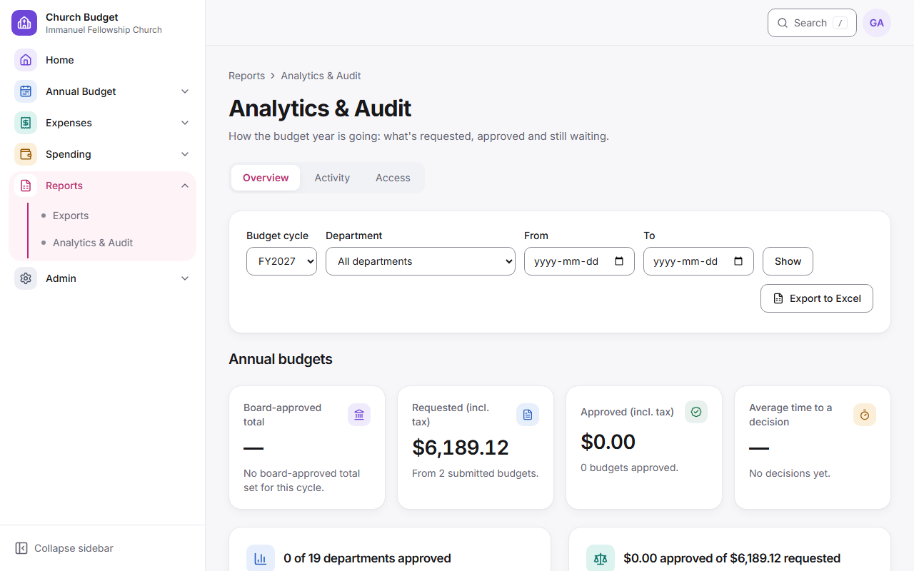

- **Overview** (accountant, backup approver and System Administrator): for the chosen budget cycle, the board-approved total and how much is approved, requested and approved totals including tax, the average days to a decision, where each department's budget is (select a bar to open those budgets on the review dashboard), requested against approved by department, and the budgets waiting longest. **Show as a table** under each chart lists the same figures; **Export to Excel** downloads them.
- **Overview, Spending and expenses** (accountant, backup approvers, Church Administrator, Board Chair, Vice-Chair and System Administrator): Available, Spent, Remaining and how much is used (the same figures as the Spending dashboard, to the cent); how many expenses wait for the accountant, the Board Chair, the requester, or to be paid, and how long payments take after approval; budget used by department (select a bar to open the department); spending by month against last year (select a month to open its ledger); how many expenses are at each status; and **How long expenses take** (days to the accountant's and the Board Chair's decisions and from approval to payment, with the expenses waiting longest). Choose a **Department** and a **From/To** date range to narrow this half; **Clear filters** shows everything again. **Export spending to Excel** downloads the spending workbook (not for the board).
- **Activity**: every action on the platform: who did it, in which role, when, on what, and why. Use the coloured quick views (Today, Decisions this week, Money changes; the System Administrator also has Failed sign-ins and access denied, Settings and role changes, and Emails that failed), search (a reference number, person or department), or **More filters** (person, role used, area, kind of event, department, cycle, dates). **Role used** narrows the log to what people did in one role; it doesn't let you act as anyone. Select a budget's reference to open it: the review screen for the accountant, or the budget itself for its own leaders. Each filter you apply shows as a chip under the search box; select its **×** to remove just that one, or **Reset filters**. Each event shows its area's icon and colour. **Show the details** on a row shows the before and after values, with changes marked. **Export to Excel** downloads the filtered log; the export is recorded too. Pages hold 50 events.
  - Who sees what: the System Administrator sees everything, including sign-ins, access denied, settings and role changes, and emails. The accountant and backup approver see the budget, expense and spending log, and the Church Administrator sees the spending log. Everyone sees what they did themselves in those areas. Sign-ins, settings and emails are the System Administrator's alone, even your own. Nobody can sign in as, or act for, someone else.
  - Each budget has its own **Activity on this budget** page, linked from the budget. Department leaders see it for their own budgets.
- **Access** (System Administrator only; other staff don't see it): the last 7 days of sign-ins by day and method, failed sign-ins, access denied attempts (with the page), people whose Group Leader check is suspended, departments without a Backup, and Planning Center mapping problems. Each item links to where you fix it.

The address keeps your filters, so you can bookmark a view or send the link to a colleague who has the same access.

**Finding things:** **Search** in the top bar (or press **/** or **Ctrl+K**) finds a budget by reference number, title, department or item, a department, a page, and (for the System Administrator) a person. Use the arrow keys and Enter, or click. Pages below the main ones show **breadcrumbs** above the title, such as "Annual Budget / Review dashboard", to step back up. For the System Administrator, **Home** shows **Recent activity**; everyone else finds it in Analytics & Audit.

---

## 10. Frequently asked questions

**How is tax calculated?** 12% of the subtotal, once, rounded to the cent. Example: $1,025.00 + $123.00 tax = $1,148.00. Every price you type is before tax. On the budget form and the review screen, **How is tax calculated?** opens the explanation beside the page without losing what you typed.

**Why was I approved for less than I asked?** The board sets each department's yearly amount; the accountant enters it including tax. See the decision email or Messages.

**Does answering a question use one of my two edits?** No.

**Can I upload quotes or documents?** Receipts on expense claims, and a quote, invoice or photo on a purchase request (up to 5 files, 10 MB each). On an annual budget, use product links and notes instead.

**I didn't get an email.** Check spam, then My tasks, which always shows what needs you. Ask the System Administrator to check **Admin → Notifications & Audit**.

**Someone else in my department started the budget.** That's fine: everyone in the department works on the same one.

**Can I get reminders by text instead of email?** Texts come as well as emails, not instead, if your Planning Center profile has a mobile number. Reply STOP to stop the texts. See **Reminder texts** in section 1.

**How do I change my personal information?** On the **Help** page, under **Your personal information**, choose **See my information** or **Correct my information**, add the details and send it (once a day). The System Administrators are emailed and reply within 30 days. Financial records are kept for the retention period and aren't deleted on request. The **Privacy** notice (in the footer, and on the sign-in screen) explains what's kept and why.

**Who do I contact?** The System Administrator for access; the accountant for budget and expense questions.
